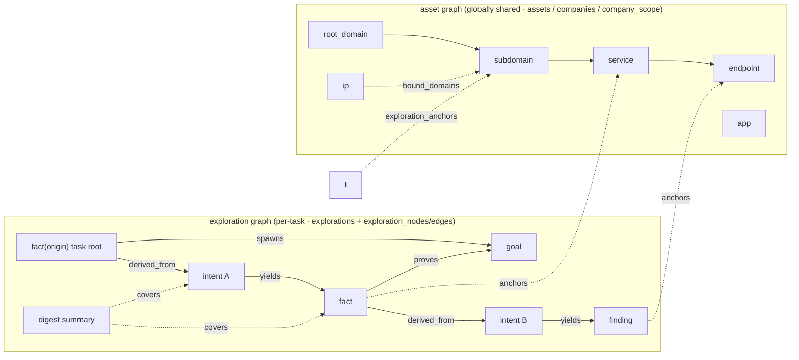
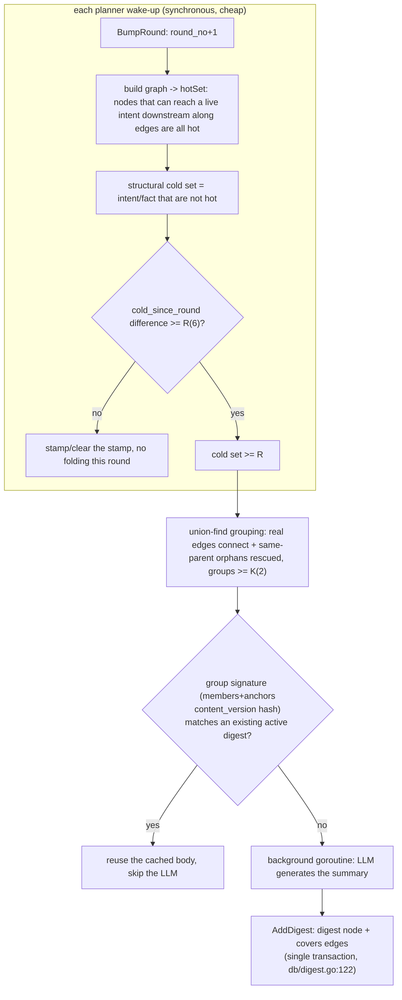

# ARTEX Design Document 01: Dual-Graph Architecture (asset graph + exploration graph)

> Reconstructed from the v0.3.15 code; the original design document was lost. This document is reverse-engineered from the implementations in `db/schema.sql`, `db/assets.go`, `db/exploration.go`, `db/digest.go`, `agent/tools_insert.go` and others.

**What this covers**: ARTEX splits all the state a pentest needs into two mutually independent graphs — the **asset graph** (a globally shared source-of-truth for "what objects were tested") and the **exploration graph** (a per-task lineage chain of "how we thought and how we progressed"), stitched together by a small anchor table. The motivation: assets are objective facts reused across tasks and should not be lost when a task ends; whereas the exploration process (intents, conclusions, vulnerabilities, hints) is a task-private reasoning chain, and mixing it across tasks only cross-contaminates. Understanding these two graphs' nodes, deduplication keys, state machines and invariants is the prerequisite for understanding all planner/worker behaviour.

## 1. Overall layering and the two graphs' division of labour

Division principle (also in the README's "Dual-graph architecture" section): **the planner reads exploration-graph situational state and produces intents; the worker claims an intent, executes it, writes new assets/facts/vulnerabilities back to both graphs, and stops**. The asset graph is shared fact, the exploration graph is the progression chain, and the two are mutually queryable through anchors.

## 2. The asset graph (globally shared)

### 2.1 Six asset types and their deduplication keys

`assets` is a single table with multiple types (schema.sql:40-113), `type` being one of six, each defined by a **partial unique index** for deduplication (schema.sql:83-91):

| type | Dedup key | Key columns |
| --- | --- | --- |
| `root_domain` | `domain` | icp |
| `ip` | `ip` | c_segment / bound_domains / open_ports |
| `subdomain` | `(domain, COALESCE(record_type,''))` | record_value / ip |
| `app` | `bundle_id`, or `app_name` when there is no bundle_id | category / app_description |
| `service` | http: `url`; other: `(domain, ip, port, service_name)` | technologies / auth / page_title / favicon |
| `endpoint` | `(url, method)` | params |

All dedup keys are computed by the program (normalization, URL parsing, `calcCSegment` computing the /24 or /48 network, `db/assets.go:139`); the agent only submits raw information — the `insert_assets` tool (`agent/tools_insert.go:122`) dispatches by `type` to seven Upsert functions. On a dedup conflict the upsert semantics are "append-merge": array-like columns (technologies / auth / params / record_value / bound_domains / open_ports / task_ids) all merge as `unnest(old || new) DISTINCT`, and scalar columns use `COALESCE(EXCLUDED, assets)` to fill only gaps, never overwrite. `service_name` is lowercased for normalization (`db/assets.go:840`), so "SSH" and "ssh" do not split into two rows.

`assets.ip` must be a real address (`ValidateAssetIP`, `db/assets.go:315`): the network-attribution layer casts that column to `::inet` for range matching (schema's `try_inet` tolerates dirty data), and a hostname written into ip silently fails to match with nobody the wiser — so the entry point errors out with corrective guidance, letting the agent fix it on the next round.

### 2.2 Company attribution and scope: two sources, explicit and scope

- `companies.nkey` is the normalized unique company name; `company_scope` has five range kinds (domain / ip / cidr / icp / keyword, schema.sql:115-148) entered by the agent via `add_company_scope` (`agent/tools_insert.go:377`), of which domain, network and ICP **automatically claim** matching existing assets (`ResolveCompanyWithICP` is called on every upsert), while keyword only serves as a range hint to the agent.
- `assets.company_source ∈ {explicit, scope}` (schema.sql:49-50): `explicit` = explicitly specified by a human/caller, `scope` = derived from company scope rules. **Every upsert's company-override CASE obeys the same invariant: an explicit attribution is never wiped out by a scope recomputation** (`db/assets.go:289-296` and elsewhere). When migrating existing databases everything is conservatively recorded as explicit (schema.sql:104-110), so a single scope rebuild cannot clear historical manual associations.
- Scope resolution and the asset writes that consume its result are serialized inside the same transaction (`withCompanyScopeMutation`, `db/assets.go:104`), otherwise concurrent attributions lose each other's updates.

### 2.3 Insert side effects: one submission drags out a whole host chain

`UpsertSubdomain` also upserts its root domain; A/AAAA records are each upserted as `ip` assets and update `bound_domains` (`db/assets.go:476-500`). `UpsertHTTPService` / `UpsertEndpoint` / `UpsertOtherService` all go through `linkHostAssets` (`db/assets.go:939`): the host is also registered as standalone root_domain + subdomain assets, and the IP gets open_ports recorded. The point: coverage denominators, the asset coverage graph and anchors must all hold on these types — the root domain must not be absent just because the agent only reported a URL.

### 2.4 Task attribution and lineage

- `assets.task_ids BIGINT[]` is the compatibility primary-key association (queried via a GIN index); `task_asset_links` (schema.sql:648-663) additionally records **how** the association happened (source=system/agent/legacy/derived + source_node_id pointing at the specific intent), kept in sync with the array by the `sync_task_asset_links` trigger (schema.sql:667-683).
- `task_scope` (schema.sql:738-761) is the task's **authorization boundary + coverage denominator**: assets explicitly `insert_assets`-ed by the worker at top level automatically enter scope at a conservative granularity (`AddAutoScope`, `agent/tools_insert.go:364`), while side-effect-derived assets do **not**; `add_task_scope` lets the planner/main agent widen it deliberately (root domain/company/ICP). The goals decomposer's round 0 also extracts scope from the task description (`agent/goals.go:53`).
- Coverage = the share of in-scope assets that have been **anchored** by fact nodes — the numerator is exactly the product of the anchor table below.

## 3. The exploration graph (per-task)

### 3.1 Seven node kinds and the state machine

`exploration_nodes` (schema.sql:170-246) is per task, with `kind` being one of seven and `state` constrained by per-kind CHECKs (`db/constants.go:4-40` defines the constants):

- **begin** (deprecated): the old task root; new tasks instead seed a `kind='fact', state='origin'` root fact (`StateOrigin`, `db/constants.go:26`), so "every intent connects to a fact" holds from the very first intent.
- **goal**: `open -> met | abandoned`. The planner proves them one by one with `prove_goal`, and the last met one triggers task completion.
- **intent**: `open -> running -> done | blocked | exhausted | stopped | paused | deleted`. See document 02 for details; `deleted` is a soft delete (the node and all lineage are retained, with `delete_reason` recording why, `db/exploration.go:389`).
- **fact**: `confirmed | dismissed | origin`. The worker's exploration conclusion (including negative conclusions); usually one summary per intent.
- **finding**: `confirmed | dismissed`, bidirectionally linked to the findings table (node_id FK + `FindingIntents` reverse lookup).
- **hint**: `active | consumed`, strategic hints issued by a human/orchestrator.
- **digest**: `active | superseded`, the cold-node compression product (see section 5).

### 3.2 Five edge relations and the lineage invariant

`exploration_edges` (schema.sql:248-274) has primary key `(exploration_id, src_id, rel, dst_id)`, which makes it idempotent; `rel` is one of five:

- `spawns`: goal -> intent (a goal derives a direction)
- `derived_from`: fact/finding -> intent (**several facts synthesize a new intent**; the planner's add_intent forces the parent to be a fact/finding, with top-level directions falling back to the origin fact, `agent/tools.go:1032-1088`)
- `yields`: intent -> fact/finding (the intent produced a conclusion)
- `proves`: fact -> goal (proves the goal achieved)
- `covers`: digest -> member (compression-view only; the algorithm **deliberately filters it** when building the graph so it does not pollute causal reachability, `agent/coldgraph.go:66`)

The invariant maintainers must uphold: **every intent can be traced back to some fact along derived_from/spawns**; `CancelIntent`'s "exclusive cascade delete" (`db/exploration.go:434`) is computed precisely along this reachability — only downstream nodes whose parents all fall inside the deletion set are deleted with it, goals and the origin fact are never deleted, and shared nodes referenced by other branches are retained. Deleted intents first do a token rollup (`intentTokenRollup`, `db/exploration.go:609`) to preserve irreversible metering.

### 3.3 The activity process stream

`activity` (schema.sql:298-339) records every step of each worker/planner (tool_use/tool_result/thinking/text/result...), and is the data source for inter-worker information exchange and the UI session page. Two engineering points: tool output may carry invalid UTF-8 / NUL bytes and must pass through `utf8Clean` / `jsonbClean` before insertion (`db/exploration.go:28-64`), otherwise the whole INSERT silently fails; `kind='result'` terminal rows carry the token quadruple, and all task-wide/all-worker/per-session statistics aggregate only from result rows (`TokenStatsBySession`, `db/exploration.go:1445`), so double counting is impossible. `main_sessions` (schema.sql:346-351) supports the main agent's "new session" segment reset of the conversation without touching the graph.

## 4. Anchors: the bridge between the two graphs

`exploration_anchors(node_id, asset_id)` (schema.sql:276-281, many-to-many, idempotent): anchors an intent/fact/finding to a specific asset. It answers two questions — "which assets is this exploration direction hitting" (`graphOverview`) and "which intents tested this asset in this task and what conclusions were drawn" (`AssetRefs`, `db/exploration.go:1892`) — and is simultaneously the coverage numerator and an input to deciding "which hosts' traffic can safely be cleaned up" when deleting a task (`hostsForTaskDeletion`, `db/assets.go:1285`).

Design point: **anchors no longer act as a visibility gate** (comment at `db/exploration.go:250`) — any task can read any asset via search; anchors only preserve the reasoning genealogy. Anchors are written from three sources: the planner's `add_intent` passing asset_ids, the worker's `record_fact`/`report_finding` carrying them, and `anchorOwner(id)` writing back after `insert_assets` records (`agent/tools_insert.go:342`).

## 5. Cold-node compression (cold-digest)

The exploration graph grows without bound as a task progresses, while every planner wake-up must read the whole graph's situational state. cold-digest is a **lossless** compression: it folds intent/fact nodes that persistently have no downstream branches into digest summary nodes, keeping the members expandable by id at any time (the main agent's `expandDigest` tool).

Key mechanisms and invariants:

- **debounce counts "rounds"**: `explorations.round_no` increments on every planner wake-up (`db/digest.go:17`); the moment a node goes from "has a live branch" to "no live branch" the `cold_since_round` is stamped (`db/digest.go:33-86`), and **becoming hot again clears the stamp**, never re-stamping — guaranteeing "how long has it been cold" measures in the right direction. Thresholds R=6, K=2 (`agent/coldgraph.go:45`).
- **Hot-set rule**: nodes that can reach an open/running/paused intent downstream along edges are all hot (the whole upstream chain of a live branch is not folded), and direct child facts just produced by a live intent are hot too (`agent/coldgraph.go:105`). finding/goal/hint/begin are never folded.
- **Change detection**: `content_version` increments on any write that would change the summary content (SetNodeState / SetIntentState / SoftDeleteIntent) (`db/exploration.go:269/356`); the group signature = SHA-256 of the sorted member ids+versions and anchor ids+versions (`agent/coldgraph.go:285`), and a recompression with the same signature reuses the old body directly, burning no LLM.
- **Consistency**: `AddDigest` writes the digest node and covers edges in one transaction; `SupersedeDigests` deletes the covers edges **at the same time** as it retires (`db/digest.go:201`), and `CoveredMembers` counts only active digests with duplicate coverage taking the smallest digest id (`db/digest.go:153`), so there is never a torn read where "a member is counted by two summaries". LLM compression runs in a detached goroutine and never adds latency to a planning round.

## 6. Idempotent schema migration design

`db/schema.sql` is `go:embed`-ed into the binary and **Executed in full on every startup**, so every migration must be idempotent. Conventions (used throughout):

- Table/index creation always `IF NOT EXISTS`; functions `OR REPLACE`; triggers `DROP TRIGGER IF EXISTS` before creating.
- Adding columns always `ADD COLUMN IF NOT EXISTS`, with defaults chosen so "old database behaviour is unchanged" (e.g. `streaming DEFAULT true`, `max_tokens DEFAULT 0`).
- **Relaxing a CHECK cannot use ADD CONSTRAINT** (it fails on a name collision): uniformly "`DROP CONSTRAINT IF EXISTS` then add", or use a `DO $$` block to inspect the `pg_constraint` definition and only rebuild when the old definition lacks the new enum value (`ck_node_kind` gaining digest, `ck_node_state` gaining paused/superseded/deleted, `ck_edge_rel` gaining covers, schema.sql:204-274).
- **One-off data migrations must carry an existence sentinel**: the schema runs on every startup, so a plain UPDATE would overwrite user edits every time. The `thinking_type` split migration from `reasoning_effort` (schema.sql:462-474) uses "the column does not exist yet" as its sentinel and runs only once; the old `llm_profile_id` backfill of task chains uses `NOT EXISTS + ON CONFLICT DO NOTHING` (schema.sql:720-730).
- Seed data is always `ON CONFLICT DO NOTHING` (e.g. the ScopeSentry MCP placeholder, schema.sql:860-862), never overwriting user configuration.
- Constraints that cannot be found (inline auto-named in existing databases) are located by fuzzy-matching the definition content (`DO $$ ... pg_get_constraintdef ... NOT LIKE '%covers%'`).

The baseline for maintainers adding a migration: a fresh database and a ten-year-old database must reach the same terminal state from the same file, and it must not wipe user runtime writes on the second startup.

## 7. Invariant list (check before changing code)

1. `assets.ip` stores only real addresses; hostnames go to subdomain (`ValidateAssetIP`).
2. An attribution with `company_source='explicit'` is never overwritten by a scope upsert.
3. Scope resolution and its consumers live in the same transaction (`withCompanyScopeMutation`).
4. Every intent is traceable to a fact along lineage (enforced at the add_intent entry point).
5. Intent state transitions go through CAS (`CompareAndSetIntentState`); all terminal transitions are centralized in one place in the engine (see document 02).
6. Anchors record genealogy only, not permissions; asset visibility is filtered by task_scope.
7. Token metering aggregates only from `activity.kind='result'`; cancelling an intent rolls up before deleting rows.
8. A digest's covers edges and its state are added/removed in the same transaction; coverage determination only counts active digests.
9. schema.sql is idempotent: any new migration has no side effects under repeated execution and does not overwrite user data.
