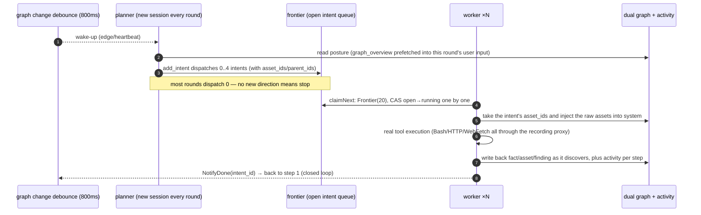
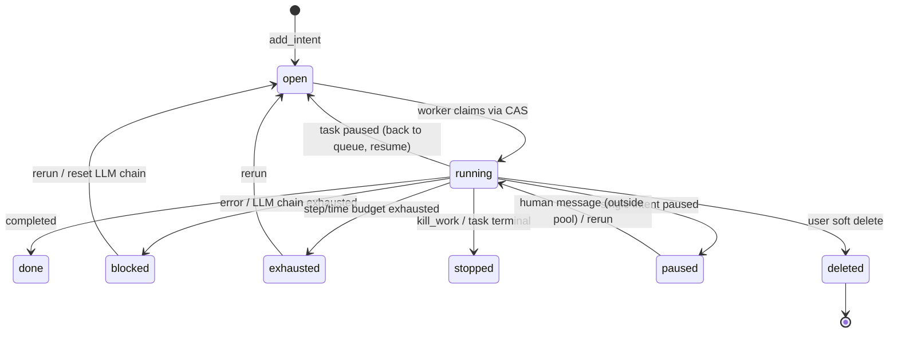
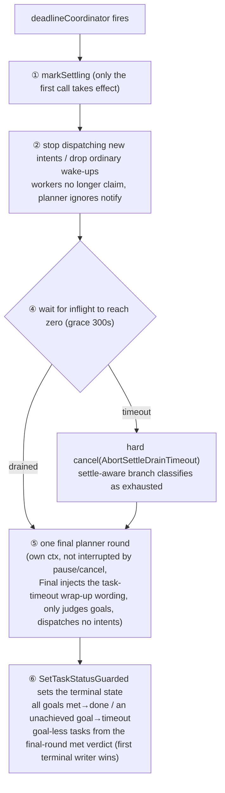

# ARTEX Design Document 02: Engine and Scheduling Closed Loop

> Reconstructed from the v0.3.15 code; the original design document was lost. This document is reverse-engineered from the implementations in `server/engine.go`, `server/engine_timeout.go`, `server/manager.go`, `server/goals.go`, `agent/planner.go`, `agent/worker.go`, `agent/goals.go` and others.

**What this covers**: the engine is an event-driven closed loop — a graph change wakes the planner, the planner dispatches intents into the frontier, workers claim intents, execute them and write back, and the write-back triggers the next round, until the goals are proved one by one or the run ends on budget/timeout. The reason for this design is that pentesting advances at a naturally uneven pace: one direction may conclude within seconds while an exploit chain may have to wait for prerequisite facts; polling-style scheduling either burns money spinning or responds sluggishly. This document covers the wake-up mechanism, the planner/worker responsibility boundary and invariants, every exit of the intent state machine, every way pause/cancel/delete/timeout can end a run, and the "execution-process-grained" information exchange between workers.

## 1. Event-driven wake-up: notify + debounce + heartbeat

Each task has one `Task` (`server/manager.go:29`) holding a `notify` channel of capacity 1. Every graph-change entry point (worker completion, finding report, a human adding a goal/hint or deleting an intent, etc.) calls `t.Notify()` (non-blocking, `server/manager.go:1751`) and records a structured event into `pendingTriggers` by event type (`NotifyDone/NotifyFinding/NotifyGoal/NotifyHint/NotifyCancelled/NotifyGoalDeleted/NotifyGoalEdited`, `server/manager.go:1762-1851`).

The planner loop (`server/engine.go:800`) wakes on two signals:

- **Edge**: `t.notify` triggers `runRound("edge")`;
- **Heartbeat**: the `heartbeat` timer triggers `runRound("heartbeat")` per `plan_heartbeat_seconds` — a deadlock backstop that also inspects running intents (long stagnation → `steer_work` correction; the whole direction is wrong → `kill_work` stop-loss), with a 600s floor (`db/tasks.go:83`).

`runRound` first does a **debounce (800ms, the `NewEngine` default)**: it merges the several notifies in one burst into a single planning round; then it passes the gates in order: planner not ready → return immediately (recovers automatically once the LLM is configured), paused / deleting / terminal / settling / goalless (when there is no open goal, whether to finish is decided by the frontier draining, `server/engine.go:845-858`) → only after all of them does it call `beginTaskOperation` to count the run in flight and actually invoke `planner.Plan`.



**First-round trigger deduplication** (`server/engine.go:772-776`): for a task with seeded intents, a seed may just have been claimed into running by a worker — so the check uses `HasActiveIntent()` (open **or** running, `db/exploration.go:1155`) instead of counting open only; otherwise it races with the worker's claim and spuriously triggers one extra planning round.

## 2. Task start-up: launchTask → goal decomposition → engine.Run

Every creation path (HTTP createTask, orchestration spawn_task) shares `launchTask` (`server/goals.go:28`): seed root assets → (optional) seed intents → `admitTask(bootstrap)`. `admitTask` is the **only admission path** (`server/goals.go:99`): with the concurrency cap on, hitting the cap / LLM not ready / an earlier waiter → durable FIFO queueing (`queued_at` nanosecond ordering guarantees FIFO even for tasks created in the same second); otherwise `startAdmittedTask` first runs **round 0, goal decomposition** (`startTaskEngine`, `server/goals.go:42`) — `DecomposeGoalsWithProvider` (`agent/goals.go:110`) uses the LLM to split the goal text into verifiable goal nodes (set_goals writes them straight to the DB) while extracting operating constraints (set_constraints) and the test scope (add_task_scope), and **only then does engine.Run start**, avoiding the race where the planner runs before the goals exist.

A task can still be created when the LLM isn't ready: the loop starts and spins until the configuration becomes usable; resuming a terminal/paused task goes through `admitTask(resume)`, the queued bootstrap mode is preserved (`queue_mode`), and the decomposition is still done after resuming.

## 3. planner: the only intent producer + a todolist shared across wake-ups

The planner is **the only legitimate intent producer in the system** (`agent/planner.go:23`), and every wake-up is a **brand-new session** — no memory. Two mechanisms keep it advancing steadily on stateless sessions:

1. **Posture prefetch**: the `graph_overview` return is concatenated directly into this round's user input (`renderGraphOverview`, `agent/planner.go:287`), and the trigger events (which intent ended, what conclusion it produced, which fact ids it yielded; who reported a finding; what a human added) go first (`renderTriggers`, `agent/planner.go:173`). The system prompt keeps only the static planning body — **stable every round, good for prompt caching**.
2. **A todolist shared across wake-ups** (`Planner.todoFor`, `agent/planner.go:108`): one `TodoStore` per exploration, resident across wake-ups. A serial exploit chain (injection point → credentials → lateral movement → privilege escalation) is recorded once, and each round only dispatches an intent for the step whose "prerequisite is done and the fact it depends on already exists", updating the list with TodoWrite — avoiding a one-shot parallel dispatch where downstream steps spin and repeat because their prerequisites don't exist yet.

The planner's output discipline is hard-coded in the prompt (`agent/planner.go:298`): **a hard floor** — when the goal isn't met and there is no open/running intent it must produce at least one intent (otherwise the task stalls); in other cases dispatching 0 is a normal result but needs a reason (already covered / waiting on a dependency). Deduplication mainly compares the summary against open+running+recent_done; a done intent is re-dispatched only when a "materially new mechanism" appears; for exhausted/blocked, first look at what the trace actually achieved before deciding to continue, re-dispatch or change approach. At most 4 intents per round, submitted in one batch `add_intent`.

**Goal adjudication** is also a core planner duty: `prove_goal(goal_id, evidence_id)` one by one; quantitative acceptance (coverage, flag count) must check the measured values, and signing off early is strictly forbidden. When the last goal is met the engine calls `SetTaskStatus("done")` and `cancelExec(AbortGoalMet)` to cancel running workers (`server/engine.go:886-894`).

## 4. The frontier intent queue and worker claiming

The frontier is exactly the `exploration_nodes` rows with `kind='intent' AND state='open'`, ordered by `priority DESC, id ASC` (FIFO within a priority) (`Frontier`, `db/exploration.go:1136`; backed by the partial index idx_expnodes_frontier). The worker loop (`server/engine.go:916`):

```
loop: paused/settling/terminal → sleep 1s and continue
  → claimNext: Frontier(20), trying ClaimIntent one by one (CAS open→running, owner=work#N)
  → claimed → runWorkerStep → runIntent
  → not claimed → sleep 800ms and retry
```

CAS claiming guarantees **at most one worker per intent at a time**; running intents left over after a restart are put back to open in bulk by `ResetRunningIntents` (`db/exploration.go:312`; the worker resumes from the transcript, so reopening is safe). A human messaging a paused intent goes through `runDetachedIntent` (`server/engine.go:1171`): it does a **CAS paused→running** in an independent goroutine outside the pool and resumes directly (never passing through open, so the pool can't grab it), occupying no pool slot and responding to the user immediately.

## 5. Worker execution and write-back: stop once done

A worker claims **one** intent, completes it, writes the findings back to both graphs, and then stops (`agent/worker.go:23`). Three responsibility boundaries are written into the system prompt: don't invent new directions (put leads into the fact summary for the planner), don't work on other intents, and only write-backs count. The intent itself **lives in the system prompt** (together with the start-up instructions and the anchored raw asset data, `agent/worker.go:384-420`) — the system prompt is rebuilt on every run and is never compacted away, so the intent is always present in a long run; the global posture overview is demoted to a user message (staleness is tolerable).

The write-back trio (`tsx.WorkerTools()`, `agent/tools_insert.go:644`):
- `insert_assets` → the asset graph (with the asset intercept gate, see document 04);
- `record_fact` → the exploration graph (**one summary per intent**, with evidence/confidence; negative conclusions are recorded too);
- `report_finding` → the exploration graph + the findings table (a real trigger must produce a PoC; a fingerprint match doesn't count).

Each step's execution is persisted to activity through `emitActivity` (a single point dispatching both storage and SSE broadcast, `server/engine.go:640`); a write failure is retried 3 times and, if it still fails, is **logged explicitly** (including the FK scene diagnosis `ExplorationDiag`), no longer silently dropped. A finding landing in the DB immediately wakes the planner (`NotifyFinding` wakes it mid-run with the finding context).

## 6. Every exit of the intent state machine

`runIntent` (`server/engine.go:982`) is the single execution + settlement point (shared by the pool path and the human-message path). Terminal routing is decided in order, and **all of it goes through CAS** (`CompareAndSetIntentState`, `db/exploration.go:363`) to prevent stale overwrites:

| Case | Terminal state | Notes |
| --- | --- | --- |
| Normal completion | `done` | the worker returned ReasonCompleted |
| Execution error (non-quota) | `blocked` | LLM/network failure, essentially nothing was probed |
| Step cap hit / run timeout | `exhausted` | cut off mid-probe with only partial write-back — this tells the planner to change angle rather than skip it as already covered |
| LLM chain exhausted | `blocked` + blocked_reason=`llm_quota_exhausted` | after the user saves/resets the chain, `ReopenIntentsByBlockedReason` reopens them in bulk |
| Task paused | **back to open** (not terminal) | re-claimed after resume; the worker resumes from the transcript |
| Hard cancel during settlement | `exhausted` | timeout settlement; don't mislabel it blocked |
| Task already terminal | `stopped` | the settling run cancelled after completion |
| planner kill_work / user cancels a single intent | `stopped` (cancellation first parks it as paused awaiting cleanup) | no write-back, no automatic re-claim |
| work-level pause / user pauses a single intent | `paused` | `ControlWork` returns after waiting for the worker to stop writing completely |
| User soft delete (any preceding state) | `deleted` + delete_reason | keeps the node and its lineage (SoftDeleteIntent) |
| User hard delete | physical delete | CancelIntent owns the cascade |

Ending always calls `NotifyDone(intent_id)` to wake the planner. **An intent that ends on model_error is additionally rerun** at most 2 times, 3s apart (`server/engine.go:71-75`), giving the provider time to recover — but only while the intent still belongs to this work and the task isn't paused/terminated/settling; a quota error that already advanced the task's LLM cursor is **not** rerun (avoiding replaying the whole intent on a backup model and producing duplicate side effects).



## 7. Pause / resume / cancel / delete

- **Task pause**: `Engine.Pause` sets paused and calls `cancelExec` (cancelling the exec ctx of the running planner/worker, `server/engine.go:178`). A running worker detecting the pause cause → the intent goes back to open; during paused, everything `execContextFor` hands out is a **pre-cancelled** ctx (preventing the claim→execute race, `server/engine.go:324`). Resume clears paused and Notifies a new planning round.
- **Single-intent control**: `ControlWork` (pause/cancel, `server/engine.go:427`) registers a `workExecution{cancel, done}` and returns only after the done signal from `detachWork` confirms the worker has stopped writing, avoiding a race with intent-delete cleanup. The cancel path first parks the intent as paused and then does the cancel cleanup on the API side — an HTTP disconnect leaves no ghost running rows.
- **planner correction / stop-loss**: `SteerWork` enqueues a message (`steerBox`); the worker's `steerHooks.PreToolUse` drains it before the next tool call and **blocks that call**, feeding the message back to the model as feedback to re-plan — without killing the process (`server/engine.go:493/531`).
- **Delete**: `BeginDelete` atomically installs the barrier (paused + deleting under deleteMu); already-admitted writers are all reflected in inflight and later ones are rejected; after data cleanup, `StopTask` cancels the task-level runtime ctx, waits for every goroutine to exit, and clears the in-memory state item by item (`server/engine.go:187/247`).

## 8. Task-level timeout settlement sequence

A task with `timeout_seconds` uses an **absolute wall clock**: on its first real run `stampFirstRun` stamps `first_run_at/deadline_at` (`server/engine_timeout.go:96`, stamped only once per process). From then on:



Run-level and task-level wall clocks are clamped by `clampMaxDuration` (`agent/taskclock.go`): a worker's MaxDuration is min(its own budget, time left to the deadline); when it fires, the SDK interrupts the running tool and settles in place (the `Settlement` hint asks it to write back what it has identified first and then summarise in one sentence, `agent/worker.go:154`) — an abandoned run doesn't lose facts. The revival path from timeout back to running is cleaned of old state by `resetTimeoutRevival` (`server/engine_timeout.go:87`).

## 8a. Task auto-finish criteria (v0.5.0)

Timeout is not the only exit. After every regular planning round (`runRound` in `server/engine.go`), the engine:

1. counts `facts / findings / tested assets` exactly (`db.CountExplorationProgress`);
2. writes `task_progress` (`round_no` fencing, so a late/duplicate round isn't counted twice):
   any counter growing → `idle_rounds=0`, otherwise +1;
3. decides with the pure function `evaluateAutoFinish` (`server/auto_finish.go`):
   - **goal_met**: the planner explicitly judges the goal met and `open+running intents = 0` → `done` directly
     (no extra planner round);
   - **auto_idle**: `round ≥ min_rounds` and `idle_rounds` consecutive rounds with zero growth and no running intents;
   - **auto_coverage**: coverage ≥ threshold (default 0 = off) and at least 1 round of zero growth and no running intents;
   - **auto_rounds**: the max planning rounds is reached (default 80, 0 = unlimited); it may finish even with intents present (drain first).
4. the settle action is **not executed inside runRound**: it only records `task.pendingSettleReason`,
   and plannerLoop calls `settleTaskWithReason` after this round's inflight is released (so the settle's
   own drain doesn't count itself and wait 5 minutes for nothing).
5. the settle terminal state follows goal achievement: every goal `met` → `done`, any unachieved goal →
   `timeout` (goal-less tasks are decided by the final planner round), with the reason written into activity;
   the final planner uses `plannerAutoFinishDefault` (not the timeout wording).

Global settings (the system settings page's "task auto-finish"): `auto_finish_enabled` (on by default),
`auto_finish_idle_rounds` (3), `auto_finish_min_rounds` (5),
`auto_finish_coverage_pct` (0 = off), `auto_finish_max_rounds` (80).
When the user adds a goal/hint through the main agent, this round's trigger resets the idle counter to zero;
paused/queued tasks aren't judged, and the counter is preserved after resuming. On revival from a terminal
state `ResetTaskProgress` starts over.

## 8b. Coverage accounting and posture slimming (v0.4.27)

Three corrections driven by task 5's measured data (1.21 billion input tokens / 66 vulns of which 64 pending / endpoint coverage 30%):

**1) Automatic anchoring for record_fact (coverage accounting)**. After probing with Bash curl at scale, workers wrote facts without
`asset_ids`, so coverage couldn't be reconciled — probing amounted to nothing. Now, when the model gives no anchors, `recordOneFact`
(`agent/tools.go`) extracts URLs/hosts from the fact text, and `AssetStore.ResolveHostAssets`
(URL exact/prefix, domain/root_domain) looks up this task's assets and anchors them automatically, capped at 6. An anchor is a
provenance edge: it only affects coverage statistics and lineage, not the fact content; when the model explicitly provides asset_ids it doesn't interfere.

**2) Untested assets ordered by cluster**. `ListUntestedAssetsWithSources` no longer sorts by id: static resources
(js/css/images/archives and similar extensions) sink to the bottom, and the rest are clustered by "host + first path segment" — one intent
can consume a whole cluster of endpoints (task 5's /prod/prod-api had 69 in the same cluster).

**3) Worker posture slimming**. Worker start-up now uses `workerOverviewData` (`agent/tools.go`):
only goals/hints/counters/latest findings/facts/the tool inventory/root task are injected; the planner-only
cold_digests, lineage edges, TokenByIntent, coverage CTE, frontier and related_tasks
never enter the worker conversation. Workers consume 76.8% of a task's tokens, so every 1K saved from the fixed prefix is multiplied by the number of rounds.

**4) Transient-cancel retries + intent wall clock**. A `context canceled` inside a run (provider stream cancellation etc.,
not a pause and not a kill) gets the same treatment as model_error: backoff retries twice before landing on blocked; at settlement runIntent
writes `wall_ms`/`terminal` into the intent payload and `compactIntents` carries them into the posture — "how long this direction burned"
is auditable on the graph. For LLM usage aggregated by role see `db.UsageByWorkerTask`.

**5) Intent-level soft budget and repeated-call interception (v0.4.28, the first P0 batch from the peer comparison)**.
- Budget: `intentBudgetWatcher` (server/engine_guard.go) wraps the emit layer of runIntent,
  reads activity's cumulative usage (Input+Output), and once `intent_budget_tokens` is reached (default 3 million)
  injects one wrap-up reminder via `SteerWork` — only once, without killing the process. In task 5 every single intent measured
  ≈3 million input, and the excess was mostly spinning.
- Repeat interception: `repeatTracker` (engine_guard.go) hooks into `steerHooks.PreToolUse`; the same tool +
  identical arguments after JSON normalization appearing ≥3 times in a row blocks this call and feeds back a correction hint;
  the same string is blocked at most 2 times and then allowed (to prevent a livelock). Both can be disabled via settings.

**6) Tool output load reduction / verbatim evidence re-verification / injection alarms (v0.4.29, P0b)**.
- Echo budget: worker `MaxToolOutputChars=12000` (the SDK's global Capture handles persistence + the pointer).
- Evidence re-verification: runIntent builds an `agent.ToolOutputLedger` (the tool_result Detail is exactly the text the model saw),
  and `report_finding` compares evidence line by line (lines of ≥20 bytes) with a three-tier provenance decision; warn by default,
  and with `finding_evidence_verify=block` a critical/high finding with zero provenance is rejected. Implementation in
  `agent/tool_outputs.go` + `addFinding` in `agent/tools.go`.
- Injection alarms: a high-precision signature hit in `scanInjection` (server/engine_guard.go) → a SteerWork reminder,
  ≤3 times per intent; `tool_output_injection_guard` can turn it off.

## 9. Process-level information exchange between workers

Valuable observations often appear in a worker's **execution process** without being written up as a formal fact. For that, workers have cross-work search ability (`tsx.WorkerTools()`, `agent/tools_insert.go:653`):

- `search_all_worker_traces(q)`: keyword search over the activity of **other** works in this task (`ActivityTraceSearchExcluding` automatically excludes the steps of its own intent, `db/exploration.go:1930`); hits carry the intent_id;
- `get_worker_trace(intent_id, [step_ids])`: pin one work and either list step summaries or fetch the **full detail** by id (`ActivityByIDs`);
- `node_detail(id)`: once you have a node id, fetch its full detail.

Information flows between workers at "execution process" granularity while the boundary is unchanged — each worker still only does the intent it claimed. **The read boundary has dedicated terminal-state protection**: trace reads in inheritance scenarios (related tasks) all use the `ForTerminalIntent` variant, putting the "intent is terminal" check and the row read into the same SQL statement (`db/exploration.go:1517/1638/1790`), so the instant a source task reopens an intent it doesn't leak the newly running trace; thinking/usage rows are never exposed.

## 10. Resuming from empty turns

On a turn where the model only emits thinking, with neither text nor a tool call, the harness treats it as a natural end — and an unfinished intent breaks off halfway. When `steerHooks.Stop` detects a thinking-only turn it injects a resume instruction (continue with the thinking already done rather than resending the prompt verbatim so it thinks it all over again), capped at `defaultEmptyTurnNudges=2` (`server/engine.go:531-620`). Note this quota is **per intent in total** and sits outside the model_error rerun loop (a rerun doesn't reset it); the harness's own stopHookActive already limits "consecutive empty turns get only one nudge", and this gate blocks the pathological "tool → empty turn → nudge → tool → empty turn" cycle from burning the whole budget.

## 11. Maintainer quick reference

| Change | Location |
| --- | --- |
| Add a planning trigger event | `manager.go` Notify* + `planner.go` TriggerEvent/renderTriggers |
| Add an intent terminal state | schema `ck_node_state` + the `runIntent` routing in the engine + the state semantics in the planner prompt |
| Change the wake-up cadence | `NewEngine` debounce / `plan_heartbeat_seconds` |
| Change the timeout sequence | the constants in `engine_timeout.go` + `settleTask` |
| Add a worker tool | `tools*.go` + `WorkerTools()` (and check the default intercept tool allowlist at the same time) |
