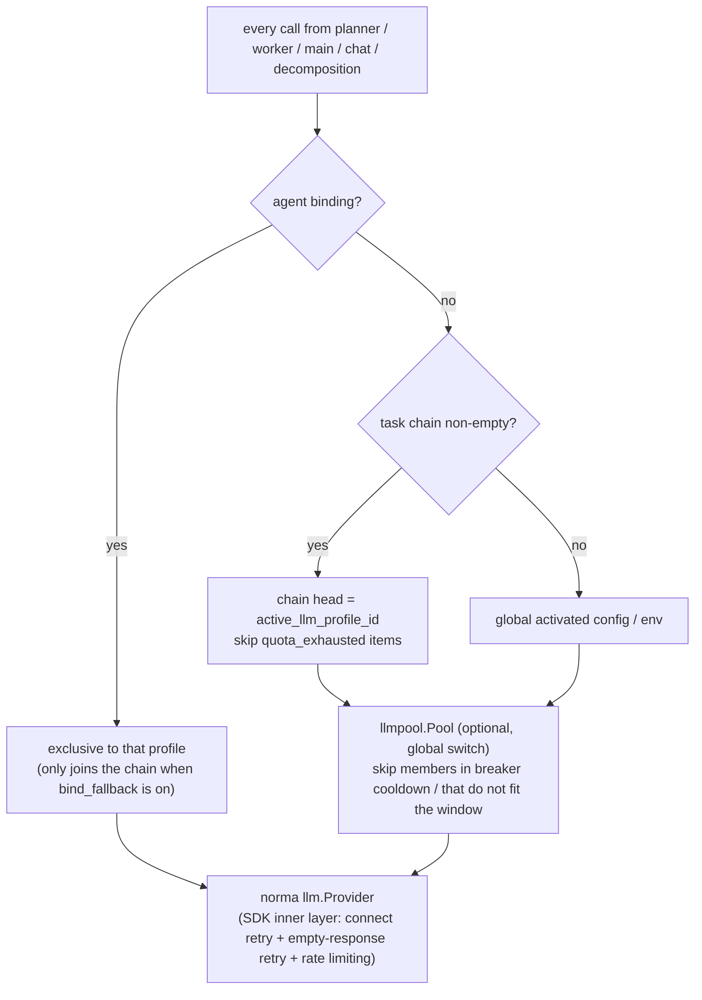
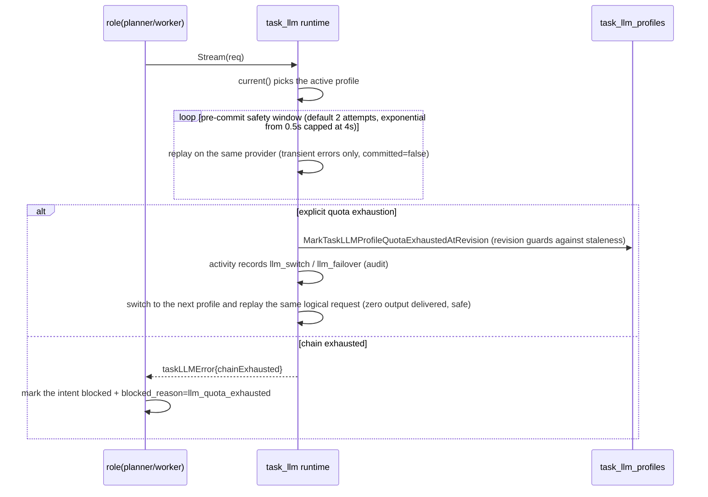

# ARTEX Design Document 03: LLM Access Layer

> Reconstructed from the v0.3.15 code; the original design document was lost. This document is reverse-engineered from the implementations in `llmpool/`, `llmrec/`, `server/task_llm.go`, `server/llmpool.go`, `agent/provider.go`, `db/llmretry.go`, `db/llmhealth.go`, `db/llm_usage.go` and others.

**What this covers**: the whole system (planner/worker/main agent/chat/goal decomposition/fallback judge) shares a single LLM access pipeline of "config resolution -> retry -> circuit breaking -> failover -> recording -> metering". The reason for this layering: a pentest easily makes thousands of model calls, and exhausted balances, invalid keys, rate limits and gateway flakiness are the norm rather than the exception; moreover, switching models mid-session must never duplicate output (otherwise the conversation history is corrupted and tool side effects double). This piece explains the three-tier routing priority, the two-level circuit-breaker criteria, the core safety invariant called the "pre-commit safety window", and the ownership rules for the five retry layers and token metering.

## 1. Three-tier routing priority

Every real call is resolved by `taskLLMRuntime.current()` (`server/task_llm.go:110`), with a fixed priority:

1. **agent binding** (`agents.llm_profile_id`): once a role is explicitly assigned a model it runs on it exclusively — by default **exclusive**, failure means failure; it only falls back to the chain when `llm_pool_bind_fallback` is enabled (`poolForBinding`, `server/llmpool.go:147`).
2. **task LLM config chain** (`task_llm_profiles`, schema.sql:696-730): after a task chain is built the items are ordered by `position`; each item has a `ready | quota_exhausted` state, and **quota-exhausted items are skipped until the user saves/resets the chain** (a reset also clears all failure states, `ReplaceTaskLLMProfiles`, `server/manager.go:1050`). The chain head is `active_llm_profile_id`.
3. **global config**: the activated config in the database, or environment variables (`FromEnv`, `agent/provider.go:145`) as a fallback.

Resolution failures are handled in layers: the task chain exists but is entirely exhausted -> return `taskLLMError{chainExhausted}` and hard-stop (**never silently fall back to global**, which `SetAuthoritativeAgentResolver` exists specifically to guarantee, `server/engine.go:713`) — a task on an exhausted chain quietly continuing on the global key both burns someone else's money and violates the user's intent in building the chain.

## 2. Ordered failover chain (llmpool)

`llmpool.Pool` implements the `llm.Provider` interface and wraps an ordered chain of members (`llmpool/pool.go:82`). The chain is built on the server side (`poolChain`, `server/llmpool.go:80`): **the chain head is always the currently effective config** (the global activation or the bound item, with Rank=`RankActive` overriding all user priorities), followed by members ordered by `priority DESC`, with `pool_exclude=true` configs kept out of the chain. Members of the same rank **take turns leading** (`rotateGroups`, `pool.go:189`) — configuring several at the same priority naturally load-balances.

Before each call `order()` filters: skipping members in breaker cooldown, skipping members whose context window cannot fit this request (a rough ~3.5 characters/token estimate, preferring to overestimate, `estimateTokens`, `pool.go:274`); **when everything is filtered out it still probes the chain head** — stalling the engine is worse than failing once more (`pool.go:181`).

**The single hard rule (the soul of this module)**: a member may only be abandoned **before it has delivered any event to the caller** (`pool.go:79-82`). Once a text/tool_use event has been yielded, switching models and resending duplicates output and pollutes the conversation history, so a mid-stream failure is propagated as-is for the harness's resume logic to handle. Fortunately, the failures this mechanism must handle (402 balance, 401 key, 429, 5xx) all surface during connection establishment, naturally landing inside the safety window.

The failover criteria (`shouldFailover`, `pool.go:231`):
- **Never** fail over on ctx cancellation — that is the user stopping the task or a task timeout; burning a backup key is both wasteful and pollutes terminal-state diagnostics;
- **Never** fail over on 400 — the request itself is broken, so it will fail anywhere;
- Fail over on 401/402/403/404/408/429 and 5xx; fail over on no status code (connection reset/DNS/timeout).

## 3. Two-level circuit breaking and the backoff ladder

`llmpool.Registry` (`llmpool/health.go:44`) is a **process-wide shared** breaker registry — rebuilding the Pool (changing some unrelated config) does not clear known conclusions: if one task discovers a config is out of credit, other tasks skip it immediately. Two-level criteria (`Trip`, `health.go:138`):

- **Deterministic failure** (`isHardFailure`: 401/402/403/404, i.e. out of credit/invalid key/model missing) -> **trip on the first occurrence**. Such failures will not heal without human intervention, so consecutive counting is meaningless.
- **Soft failure** (429/5xx/network) -> trips only after `softTripAfter=3` consecutive occurrences (configurable; a negative value = never soft-trip).
- Cooldown follows a ladder: 1 minute on the first trip, 5 minutes on the second, then 30 minutes each time after that (`backoff`, `health.go:21`; a fixed value is configurable). A successful `Pass` clears the counter and deletes the DB row.

Memory is authoritative; the `llm_profile_health` table exists only so **the cooldown window survives a restart** (`newLLMHealthRegistry`, `server/llmpool.go:22`): on load it only takes rows with `open_until > now()` — configs whose cooldown expires during the restart naturally return to healthy, and the next call half-open probes them. Writes are asynchronous and best-effort; the UI can manually "restore now" (`Reset` -> `ClearLLMHealth`).

## 4. Task-level quota failover (task_llm) and the pre-commit safety window

Above the global chain there is another layer of **task-chain-specific** failover (`streamTaskLLM`/`completeTaskLLM`, `server/task_llm.go:287/237`), which handles exactly one thing: **errors explicitly stating balance/quota exhaustion**. The criteria are deliberately narrow (`IsQuotaExhaustedMessage`, `agent/provider.go:292`): ordinary 429s, rate-limit wording ("quota metric"/"rate limit"/rpm/tpm) and 401/403/5xx **never** trigger rotation — vendors call ordinary rate limiting "quota exceeded" far too often, so only hard phrasings like `insufficient_quota`, `billing_hard_limit`, `credit balance`, `insufficient balance` count (and only when they contain no rate-limit wording and no 401/5xx status).

Transition sequence:

`committed` is defined in `streamEventCommitOutput` (`task_llm.go:386`): delivery counts once a text delta / thinking delta / tool_input JSON / message boundary event has occurred. Before commit any retryable failure can be replayed as-is; after commit it is only propagated. **Quota exhaustion is the exception**: even after commit, the profile must first be marked exhausted (chain advancement is irreversible bookkeeping), but the error is wrapped as a `taskLLMError` that is **not** chainExhausted, so the worker side does **not** replay the whole intent on the backup model (`isTaskLLMRouterError` excludes it from model_error reruns, `server/engine.go:82`) — partial streaming output may already have driven tool execution, and replaying would duplicate side effects.

Chain state changes (revision guards against staleness: if the user changes the chain midway, old advancement results are voided) emit an activity audit row (`emitTaskLLMTransition`, `task_llm.go:618`), kind=`llm_switch` (automatic switch) / `llm_failover` (chain exhausted) / `llm_switch`+mode=manual (user manual switch).

## 5. Five retry layers

The same transient failure has five independent lines of defence, each independently configurable (`RetryRule` semantics are uniform: count 0=built-in default, -1=disabled, >0=custom; interval 0=exponential backoff, >0=fixed milliseconds, `db/llmretry.go:20`; resolution priority is profile override -> global policy `llm_retry_policy` -> built-in default, `sameProviderRetryPolicy`, `task_llm.go:414`):

| Layer | Scope | Built-in default | Implementation |
| --- | --- | --- | --- |
| connect | Inside the SDK, before the stream starts (reset/timeout/429/5xx) | 3 attempts, exponential capped at 8s | `llm.Config.MaxRetries` |
| empty (empty response) | Inside the SDK, completed but zero content blocks (openai format only) | 2 attempts | `llm.Config.EmptyResponseRetries` |
| stream (same-provider safety window) | This project, broken/overloaded stream or in-stream 429 before any output is delivered | 2 attempts, exponential from 0.5s capped at 4s | the `streamTaskLLM` replay loop |
| breaker (circuit-breaker cooldown) | llmpool, across requests | 3 soft trips + 1/5/30min | `llmpool.Registry` |
| intent (intent rerun) | engine, the whole intent after a model_error finish | 2 attempts, fixed 3s | the `runIntent` retry loop |

Why layered: the SDK can only govern "before a 200 arrives" — once a stream starts, a mid-stream break gets zero retries from it; the stream layer fills that gap, and `isRetryableStreamError` (`task_llm.go:431`) excludes quota (the chain's job), over-long context (the harness's compaction job) and deterministic 4xx — **the retry criterion is "replaying this class of failure is meaningful"**.

## 6. Request-recording decorator (llmrec)

`llmrec.Recorder` wraps the outside of each provider (`llmrec/llmrec.go:118`) and writes two rows per call:

- **Lightweight metering row** (the `llm_usage` table): **always written, not governed by the recording switch** — it drives the token statistics on the config page, so it must cover failed/interrupted calls to be accurate (`recordUsage`, `llmrec.go:267`).
- **Heavy trace row** (the `llm_records` table, with the full request/response): governed by the `llm_record` setting. Beyond the normalized view it also carries the **raw wire payload**: `llmrec.Capture` hangs on the ctx and is filled in by `quotaAwareTransport` (the layer that actually sees the bytes) — norma builds the body and decodes SSE itself, so what the Recorder sees is already a decoded view, and when debugging an online gateway only the wire bytes are ground truth. norma's connect retries mean one Stream may issue several HTTP attempts, and each attempt's status code and body are kept separately (discarded attempts are exactly the key to diagnosing rate-limit/gateway faults, `llmrec/capture.go:23`).

Usage folding details: Anthropic splits tokens across two events — `message_start` carries only the input side and `message_delta` only the output side — so `Usage.Add` must fold them; a direct overwrite would zero out the input (`llmrec.go:189-209`).

The Recorder wraps one layer per profile, so **failed attempts are also attributed to their own profile** (see the comment at `server/llmpool.go:60`).

## 7. Session header / proxy / 429->402 normalization

- **Session header**: when `session_header_key` is non-empty every request carries a custom HTTP header whose value is the current session id (read from the ctx via `transcript.SessionIDFrom`, `agent/provider.go:338-347`). This serves gateways that do prompt caching/sticky routing by session id (e.g. opencode zen returns 400 outright without this header). The same shared provider can also send different header values per session because the value hangs on the request ctx rather than the provider.
- **Proxy**: `proxy` supports http/https/socks5; **empty = direct connection and no fallback to *_PROXY environment variables** (`agent/provider.go:400-419`, explicitly setting `transport.Proxy=nil`) — the LLM egress is a boundary the user configured explicitly and should not be rerouted by environment variables unexpectedly. This is an independent path from the global egress proxy for target traffic (`m.ProxyAddr`).
- **429->402 normalization**: `quotaAwareTransport` intercepts 429 responses and, when the body matches `IsQuotaExhaustedMessage`, rewrites the status code to 402 before returning (`agent/provider.go:364-379`). Reason: the SDK's retry loop treats every 429 as transient; without normalization an out-of-credit config gets burned through idle retries before rotating, whereas after the rewrite task routing fails over immediately while preserving the original body for classification and audit. Tee rather than read: 200 is an SSE that must keep streaming, while the 429 branch's body is teed into Capture.

## 8. Token metering attribution

Attribution is assembled from three layers of information:

1. **Session id parsing** (`parseSession`, `llmrec.go:90`): `exp<N>-planner` / `exp<N>-worker-i<intent>` / `exp<N>-goals` / `conv-<id>`... the exploration id and the role are both in there. The task registration id is attached to the ctx explicitly by the task runtime via `llmrec.WithTaskID` (when it differs from the parsed id, the explicit one wins).
2. **Lane override**: calls that do not go through standard sessions (the fallback judge) use `llmrec.WithWorker(ctx, "judge")` to override the lane explicitly, so the config page can list judge consumption separately (`server/intercept.go:51`).
3. **Two ledgers**: `llm_usage` (one row per call, aggregated by profile/lane/model, the config page view) and `activity.kind='result'` (one row per run, the task page view). Task-side statistics aggregate by **intent** rather than work#N (`TokenStatsBySession`, `db/exploration.go:1445`) — worker slots are reusable, and retries/re-dispatches must land on the same row.

## 9. Maintainer notes

- When adding a new LLM call path (new agent/new judge): it must go through the same `llm.Provider` resolution chain (shared rate limiting/circuit breaking/recording) rather than bypassing it with a hand-rolled HTTP client — goal decomposition was changed to have the provider injected by the caller for exactly this reason (comment at `agent/goals.go:81`).
- When deciding "should this fail over / retry", first ask: **if this failure is replayed on another model, will it duplicate output or duplicate side effects?** Yes -> it may only be propagated; No -> switching is allowed. This is the consistent criterion across all five layers.
- When changing quota-detection wording (`IsQuotaExhaustedMessage`), always keep the "narrowing" tendency: mistaking rate limiting for out-of-credit causes meaningless rotation that burns every key on the chain.
