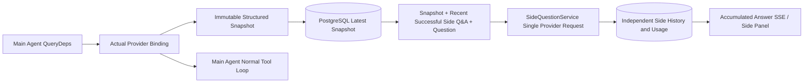

# ARTEX `/btw`

Normal chats, the task MainAgent, and the current task's own Workers all support independent side questions. Enter `/btw <question>` in the main input box to submit; an empty `/btw` or the "Side Question" button opens the history. Desktop uses a resizable-width sidebar, mobile uses a Drawer.

Side answers are generated from a snapshot of the Agent context at submission time, and support streaming display, follow-up questions, stop, and clear. Closing the panel, refreshing the page, or disconnecting SSE does not cancel the model request. Stop affects only the current side question; clear cancels the side question and deletes its history, while retaining the main context snapshot.

## Implementation boundaries

Reuses Go, norma v0.3.7, Next.js, and the existing Markdown / ResizablePanel / Drawer / AlertDialog components; no norma source was modified and no dependency was added for side questions. Planner, Workers inherited from other tasks, and tool-type subtask promotion are out of scope.

- `capture.go` marks main-loop requests only at `Options.Deps.CallModel / CallModelSync`. The Provider decorator sits inside the concrete model, after the routing pool's outer selection, so the actually selected model is recorded; compaction and summary requests do not overwrite the snapshot.
- Snapshots are published at request start, on the complete model reply, and on terminal run state. A half-generated reply is not published; tool calls stay paired via norma's `MessagesForAPI`, and tool results enter the snapshot on the next main-model request or at terminal state. A streamed abort retains the last valid boundary.
- Snapshots preserve structured messages, system prompts, tool definitions, and generation parameters via JSON deep copy. Model inference holds no snapshot lock or database transaction.
- `SideQuestionService` calls the concrete Provider; when needed it first generates a side summary, and the final answer is allowed a single retry after reduction only on the first context-over-limit response with no text/tool call yet emitted. No agent session is created, and it does not hook into the tool executor, main transcript, activity stream, or task graph, nor pass through the task model-switch chain. Tool definitions are retained in the answer for compatibility with existing structured tool contexts; summary requests provide no tools. Newly returned tool calls have no execution path.
- One running request per parent session, at most four per service process, with a 120-second timeout per request. Side questions use an independent cancellation context under the service lifecycle.
- Side-question requests retain a model-config reference and a non-sensitive identity summary; credentials are obtained from the existing config at request time. If the config is deleted, or identity fields such as the model, protocol, or address change, the main Agent must be run first to update the snapshot. Tests do not change the product's default model.

## Persistence and recovery

`db/schema.sql` automatically creates `side_question_sessions` and `side_question_requests`. The former stores the parent resource, latest snapshot, run number, version, and cleanup version; the latter stores the question, accumulated answer, status, model, snapshot time, usage, event sequence, and paging sequence.

The parent-session key is the conversation ID, or task ID + exploration ID + intent ID. Workers do not use reusable execution-slot names.

Snapshots are merged per parent session, refreshed every 250 ms, with the database comparing `(run_id, version)` to prevent an older version from overwriting. The selected snapshot is saved again just before side-question submission. After a successful save, the large in-memory snapshot is released; on failure the pending version is retained. Accumulated answer content is written at most every 250 ms as streaming events arrive, and saved immediately at terminal state with bounded retries on database errors.

On service startup, leftover `running` requests are marked `interrupted`, retaining the partial answer and usage already persisted, without automatically replaying the request. The most recently saved context can be used directly for the next question. If an old session has no snapshot, the main Agent must be run first; context is not rebuilt from UI activity records.

Clear increments the cleanup version and deletes requests; a conditional update prevents late callbacks from writing back. Physical parent-resource deletion relies on foreign-key cascade, while Worker soft deletion removes side-question data in the same transaction and rejects late snapshots. Task archiving first blocks new requests, waits for the main flow to stop, then cancels and waits for side-question persistence; the archive format is v3, while remaining compatible with v1/v2 that lack side-question tables.

History is fully retained, returning at most 20 items per page by ordinal cursor. Model requests replay at most the recent 20 pairs of successful Q&A original text, with the replay volume also limited by token budget; older Q&A pairs maintain a separate rolling summary. When the main context exceeds the budget, only the old portion of the side copy is summarized, preserving recent structured tool calls and results. Summaries, preparation progress, and usage are all included in the side question's concurrency, cancellation, and 120-second timeout limits. See [Context budget and open-source references](CONTEXT_BUDGET.md).

## HTTP contract

The following paths serve as `{parent}`, reusing existing authentication and resource validation:

- `/api/conversations/{id}`
- `/api/tasks/{id}/chat`
- `/api/tasks/{id}/intents/{iid}`

| Request | Return and behavior |
| --- | --- |
| `GET {parent}/side-questions?before={ordinal}` | `items` newest-to-oldest, independent `current` run state, `snapshot` metadata, `next_cursor`; a cursor of 0 means the latest page / no next page |
| `POST {parent}/side-questions` | JSON `{ "question": "…", "client_request_id": "UUID" }`; a new request returns 202 and the request object; the same ID and question returns the existing object 200 |
| `DELETE {parent}/side-questions` | Cancel and clear side questions for the current parent session |
| `GET /api/side-questions/{requestID}/events` | `snapshot` SSE event, `id` is an increasing sequence number, `data` is the complete accumulated request object; `cleared` is sent on clear |
| `POST /api/side-questions/{requestID}/cancel` | Explicit cancel; terminal state can be read from history or SSE |

The question cap is 4000 characters. No snapshot, changed model config, busy same parent session, or idempotency ID conflict returns 409; the global concurrency cap returns 429. Every SSE connection first sends the accumulated state, without relying on text fragments the client received earlier. The frontend merges by request ID + sequence number, and discards old callbacks when switching parent sessions or clearing.

## Validation and references

Automated checks, actual model usage, and known limitations are in [VALIDATION.md](VALIDATION.md).

Standalone-request reference: [Grok CLI side-question.ts (pinned commit)](https://github.com/superagent-ai/grok-cli/blob/fb97af83f06dca873281d60168430f06c8de6324/src/utils/side-question.ts); runtime isolation reference: [OpenCode (pinned commit)](https://github.com/anomalyco/opencode/tree/b3f1a96c6dd7adeb28b36dd11add1998fc84d67b). ARTEX's context uses norma's structured messages, not the approach of stitching text together from frontend logs.
